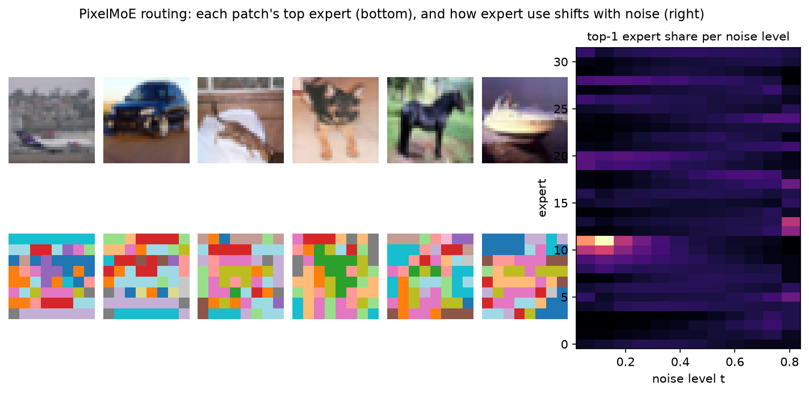
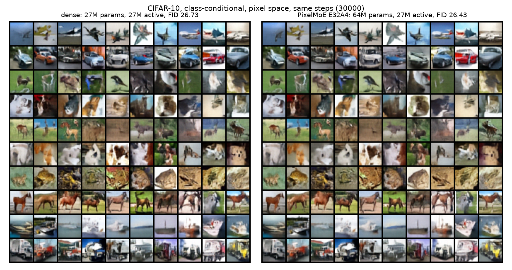

<h1 align="center">nano-pixelmoe</h1>

<p align="center">
  <a href="https://github.com/tatra-labs/nano-pixelmoe/actions/workflows/tests.yml"></a>
  <a href="https://arxiv.org/abs/2610.18857"></a>
  <a href="LICENSE"></a>
</p>

<p align="center"><b>Pixel-space diffusion with LLM-style mixture-of-experts, in about 260 lines.</b><br>
No VAE, no tokenizer: a transformer denoises raw pixels, and its feed-forward layers are routed experts.
Trains on one laptop GPU.</p>



[*PixelMoE*](https://arxiv.org/abs/2610.18857) (Dong et al., October 2026) shows that the mixture-of-experts
recipe of modern LLMs transfers to pixel-space diffusion unchanged, and reaches FID 1.47 on ImageNet
256×256 with no VAE. Its code is "coming soon". **nano-pixelmoe** is a small, independent version you can
read in one sitting and train yourself.

The figure above is from our run. Each patch is colored by its top expert: experts follow the content
(the dog's body, the plane's sky band), and different experts take over at different noise levels, with
two of them handling the final, nearly clean steps.

## What is in it

| | file | from the paper |
|---|---|---|
| token-choice routing with sigmoid scores, top-A of E fine-grained experts | [`moe.py`](pixelmoe/moe.py) | §3.1 |
| an always-on shared expert; outputs scaled by √A | [`moe.py`](pixelmoe/moe.py) | §3.1 |
| bias-based load balancing: no auxiliary loss, b ← b − γ (F − Q)/RMS(F − Q) | [`moe.py`](pixelmoe/moe.py) | §3.1, App. A |
| dense first blocks, MoE blocks after, matched active parameters | [`model.py`](pixelmoe/model.py) | §3.1 |
| hierarchical flow matching: half resolution first, then full | [`flow.py`](pixelmoe/flow.py) | §3.2 |
| stage-wise endpoint prediction with the velocity-space loss | [`flow.py`](pixelmoe/flow.py) | §3.2 |
| the covariance-matched stage transition (t_e0 = 0.75, t_s1 = 6/7, ρ = −1/3) | [`flow.py`](pixelmoe/flow.py) | App. B |
| stage-aware Logit-Normal timestep sampling, classifier-free guidance, Heun sampling | [`flow.py`](pixelmoe/flow.py) | §3.2 |

Simplified, on purpose: AdaLN conditioning on timestep and class (no in-context class tokens), a small
wide prediction head instead of the full DDT head, AdamW instead of Muon. Experts run as two batched
matmuls over a padded per-expert buffer, with no Python loop over experts. The stage transition is tested
statistically: the injected noise reproduces the Stage 1 covariance t_s1² I.

## Results on one laptop GPU

CIFAR-10, class-conditional, 32×32 pixels, patch size 4, 30,000 steps at batch 128 (77 epochs), same
seed and recipe for both; FID on 10,000 samples against the training set, guidance 1.5, 40 sampling steps.



| model | parameters | active per token | FID ↓ | IS ↑ | training time (RTX 5060 Laptop) |
|---|---:|---:|---:|---:|---:|
| dense | 26.7M | 26.7M | 26.73 | 8.15 | 69 min |
| PixelMoE E32A4 | 64.2M | 27.0M | 26.43 | 8.05 | 128 min |

At this scale the two are **tied**: the difference is within the noise of a 10k-sample FID. The paper's
gains appear at 200M+ active parameters and 100+ ImageNet epochs (Dense-B 4.40 vs PixelMoE-B 2.46 FID).
What this run does show is the mechanism working: balanced routing without any auxiliary loss (the busiest
expert ends at 1.6× the average load) and experts that specialize by content and noise level. Our MoE
step is 1.9× slower than dense at equal active parameters; that is the padded batched matmul, not the
method.

## Quickstart

```bash
git clone https://github.com/tatra-labs/nano-pixelmoe && cd nano-pixelmoe
pip install -r requirements.txt            # plus a CUDA build of torch

python train.py --out runs/moe                  # PixelMoE E32A4; CIFAR-10 downloads on first run
python train.py --out runs/dense --experts 0    # the dense twin with matched active parameters
python sample.py runs/moe --classes 1 7 9 --per-class 8 --cfg 2 -o grid.png
python fid.py runs/moe                          # FID and IS on 10k samples
python analyze.py runs/moe -o experts.png       # the routing figure above
```

`Config` in [`model.py`](pixelmoe/model.py) holds every size (width, depth, experts, active experts,
expert widths); scale it up and point `train.py` at a larger dataset to approach the paper's regime.

## Citation

An independent implementation; all credit for the method goes to the authors.

```bibtex
@article{dong2026pixelmoe,
  title   = {PixelMoE: Scaling Pixel-Space Diffusion with LLM-Style Mixture-of-Experts},
  author  = {Dong, Ruixiao and Bao, Jianmin and Luan, Bozhi and Meng, Zijie and Tao, Xin and Wan, Pengfei and
             Gai, Kun and Li, Li and Li, Houqiang},
  journal = {arXiv preprint arXiv:2610.18857},
  year    = {2026}
}
```

MIT License.
